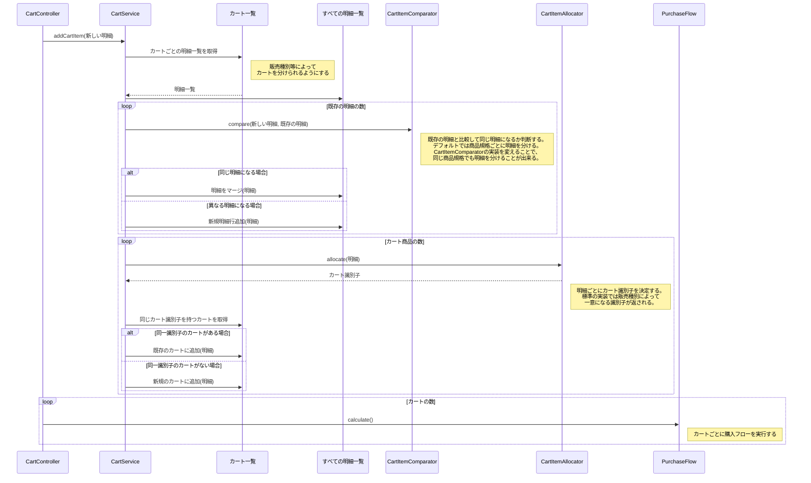
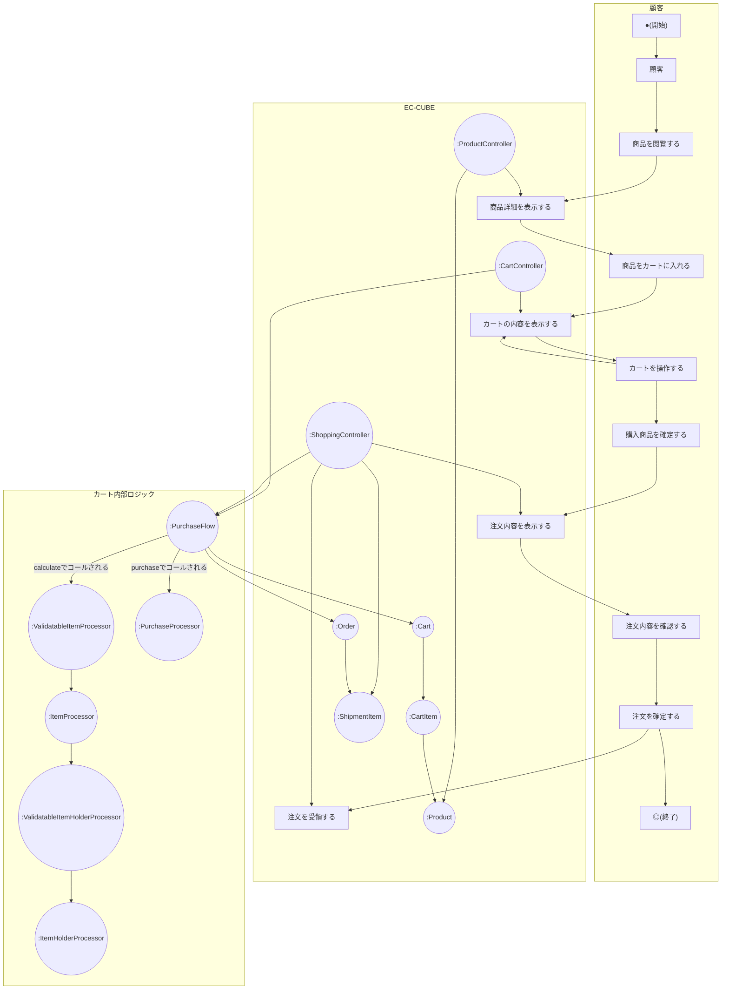
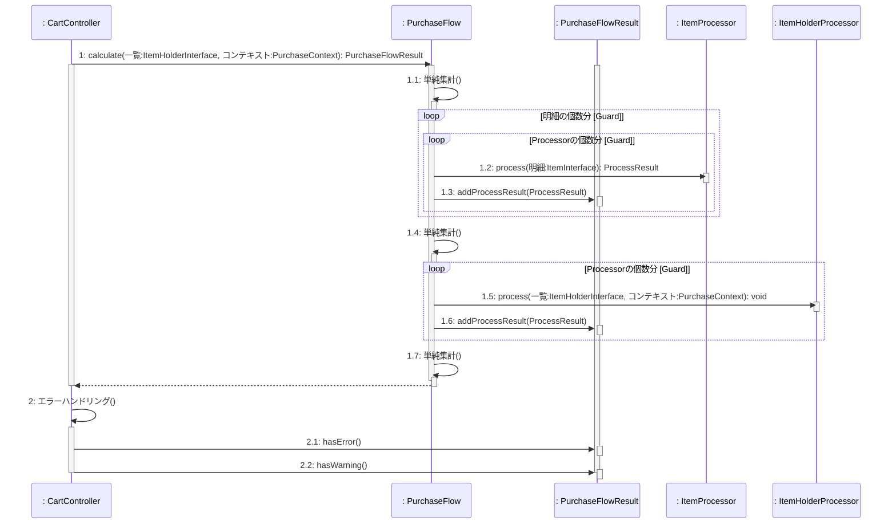

## カートのカスタマイズ [#2613](https://github.com/EC-CUBE/ec-cube/issues/2613){:target="_blank"}

`CartItemComparator` クラス、 `CartItemAllocator` クラスを実装することにより、カートに商品を投入した際の動作をカスタマイズ可能です。



### 同じ商品・同じ商品規格でも別々の明細に分割する

標準の実装では、商品規格ごとにカートの明細が分割されます。
例えば、ギフトラッピングなどの商品オプションを追加するカスタマイズをした際、 `CartItemComparator` を実装することによって、同じ商品・同じ商品規格の場合でも、ギフトラッピングの有無によって、明細を分割することが可能です。

``` php
<?php
namespace Customize\Service\Cart;

use Eccube\Entity\CartItem;
use Eccube\Service\Cart\CartItemComparator;

/**
 * 商品規格と商品オプションで明細を比較する CartItemComparator
 */
class ProductClassAndOptionComparator implements CartItemComparator
{
    /**
     * @param CartItem $Item1 明細1
     * @param CartItem $Item2 明細2
     * @return boolean 同じ明細になる場合はtrue
     */
    public function compare(CartItem $Item1, CartItem $Item2): bool
    {
        $ProductClass1 = $Item1->getProductClass();
        $ProductClass2 = $Item2->getProductClass();
        $product_class_id1 = $ProductClass1 ? (string) $ProductClass1->getId() : null;
        $product_class_id2 = $ProductClass2 ? (string) $ProductClass2->getId() : null;

        if ($product_class_id1 === $product_class_id2) {
            // 別途 ProductOption を追加しておく
            return $Item1->getProductOption()->getId() === $Item2->getProductOption()->getId();
        }
        return false;
    }
}

```

CartItemComparator を有効にするには、 `app/config/eccube/packages/cart.yaml` を作成し、CartItemComparator の定義を追加します。

```yaml
services:
    Eccube\Service\Cart\CartItemComparator:
      class: Customize\Service\Cart\ProductClassAndOptionComparator

```


### 支払方法が異なる商品を同時にカートに入れられるようにする

例えば、配送方法A/B、商品A/Bがそれぞれある場合、

+ 配送方法
    + 配送方法A:  販売種別A/クレジットカード
    + 配送方法B:  販売種別B/代引き
+ 商品
    + 商品A: 販売種別A
    + 商品B: 販売種別B

EC-CUBE3.0 では、商品Aをカートに入れ、次に商品Bをカートに入れようとすると「この商品は同時に購入することはできません。」というエラーになってしまいます。

`CartItemAllocator` を実装することで、任意の基準で、カートを分けられるようになります。
例えば、予約商品など、 **同時にカートに投入したいが、別々に決済したい(注文を分けたい)** といったカスタマイズをすることができます。

``` php
<?php
namespace Customize\Service\Cart;

use Eccube\Entity\CartItem;
use Eccube\Service\Cart\CartItemAllocator;

/**
 * 販売種別と予約商品フラグごとにカートを振り分ける CartItemAllocator
 */
class SaleTypeAndReserveCartAllocator implements CartItemAllocator
{
    /**
     * 商品の振り分け先となるカートの識別子を決定します。
     *
     * @param CartItem $Item カート商品
     * @return string
     */
    public function allocate(CartItem $Item): string
    {
        $ProductClass = $Item->getProductClass();
        $saleType = $ProductClass?->getSaleType();

        if ($ProductClass && $saleType) {
            $salesTypeId = (string) $saleType->getId();
            // 別途 ProductClass に予約商品フラグ(isReserveItem)を追加しておく
            return $ProductClass->isReserveItem()
                ? $salesTypeId . ':R'
                : $salesTypeId;
        }

        throw new \InvalidArgumentException('ProductClass/SaleType not found');
    }
}

```

CartItemAllocator を有効にするには、 `app/config/eccube/packages/cart.yaml` を作成し、CartItemAllocator の定義を追加します。

```yaml
services:
    Eccube\Service\Cart\CartItemAllocator:
      class: Customize\Service\Cart\SaleTypeAndReserveCartAllocator

```


### 購入フローのカスタマイズ [#2424](https://github.com/EC-CUBE/ec-cube/pull/2424){:target="_blank"}

集計処理や、在庫チェックなどのバリデーションは、受注に関わる共通したロジックです。
従来は、CartService や ShoppingService など、利用される画面で個別に実装されており、カスタマイズ時の影響が読みづらい、再利用しにくいなどの課題がありました(たとえば、配送料の計算ロジックを変更する際には複数箇所を修正する必要があります)

集計フローを制御する PurchaseFlow と、各処理を行う Processor に分離し、ロジックを差し替えたり、新たなバリデーションを追加するカスタマイズが簡単になりました。

#### アクティビティ
全体のアクティビティは以下の通りです。


#### フローの制御の流れ

カートを例にすると、集計処理やバリデーションは以下のように実行されています。

- セッションからカートをロードする
- カート明細の、**現在の** 状態をチェックする(明細単位で整合性を担保する)
	- 商品の販売制限数のチェック
	- 商品の在庫切れのチェック
	- 公開・非公開ステータスのチェック
	- ...
- チェック結果に応じて、明細の丸め処理を行う
    - 販売制限数
    	- 販売制限数まで明細の個数を減らす
    - 商品の在庫切れ
    	- 明細を削除する(個数を0に設定)
    - 公開・非公開ステータス
    	- 明細を削除する(個数を0に設定)
    - ...
- 集計処理
    - 合計金額、配送料、手数料等の合計を集計する
- カートの、 **現在の** 状態をチェックする(明細全体で整合性を担保する)
    - 商品種別に矛盾が生じていないか
    - 支払い方法に矛盾が生じていないか
    - 購入金額上限を超えていないかどうか
- チェック結果に応じて、エラーを返す
- 集計処理
    - 合計金額、配送料、手数料等の合計を集計する




#### クラス図

```mermaid
classDiagram
direction LR

%%========================================================
%% 基本インターフェース
%%========================================================
class ItemHolderInterface {
  + getItems() ItemCollection
  + addItem(明細: ItemInterface) void
}
class ItemInterface

note for ItemHolderInterface "Cart, Order"
note for ItemInterface "CartItem, OrderItem"

ItemHolderInterface o-- ItemInterface


%%========================================================
%% PurchaseFlow（全体制御）
%%========================================================
class PurchaseFlow {
  + validate(一覧: ItemHolderInterface, コンテキスト: PurchaseContext) PurchaseFlowResult
  + prepare(一覧: ItemHolderInterface, コンテキスト: PurchaseContext) void
  + commit(一覧: ItemHolderInterface, コンテキスト: PurchaseContext) void
  + rollback(一覧: ItemHolderInterface, コンテキスト: PurchaseContext) void
}

class CartController
class ShoppingController

note for CartController "別のFlowを使用"
note for ShoppingController "別のFlowを使用"

CartController --> PurchaseFlow
ShoppingController --> PurchaseFlow


%%========================================================
%% Holder単位の前処理（ItemHolderPreprocessor）
%%========================================================
class ItemHolderPreprocessor {
  + process(一覧: ItemHolderInterface, コンテキスト: PurchaseContext) void
}
note for ItemHolderPreprocessor "注意:冪等性が壊れやすい"

ItemHolderPreprocessor --o PurchaseFlow

class 割引明細追加
class 送料明細追加
class 手数料明細追加

割引明細追加 --|> ItemHolderPreprocessor
送料明細追加 --|> ItemHolderPreprocessor
手数料明細追加 --|> ItemHolderPreprocessor


%%========================================================
%% Holder単位のValidator（ItemHolderValidator / Preprocessorの一種）
%%========================================================
class ItemHolderValidator {
  + validate(一覧: ItemHolderInterface, コンテキスト: PurchaseContext) void
  + handle(一覧: ItemHolderInterface) void
}

ItemHolderValidator --|> ItemHolderPreprocessor

class 購入金額上限チェック
class 商品種別チェック
class 支払方法チェック

購入金額上限チェック --|> ItemHolderValidator
商品種別チェック --|> ItemHolderValidator
支払方法チェック --|> ItemHolderValidator


%%========================================================
%% PurchaseProcessor（commit/rollback系）
%%========================================================
class PurchaseProcessor {
  + prepare(一覧: ItemHolderInterface, コンテキスト: PurchaseContext) void
  + commit(一覧: ItemHolderInterface, コンテキスト: PurchaseContext) void
  + rollback(一覧: ItemHolderInterface, コンテキスト: PurchaseContext) void
}

PurchaseFlow o-- PurchaseProcessor

class 会員の購入サマリ更新
会員の購入サマリ更新 <|-- PurchaseProcessor


%%========================================================
%% Item単位の前処理（ItemPreprocessor）
%%========================================================
class ItemPreprocessor {
  + process(明細: ItemInterface, コンテキスト: PurchaseContext) void
}
note for ItemPreprocessor "冪等性は簡単に保たれる"

PurchaseFlow o-- ItemPreprocessor


%%========================================================
%% Item単位のValidator（ItemValidator）
%%========================================================
class ItemValidator {
  + execute(明細: ItemInterface, コンテキスト: PurchaseContext) ProcessResult
}

ItemPreprocessor <|-- ItemValidator

class 販売数制限チェック
class 削除商品チェック
class 非公開商品チェック
class 在庫制限チェック

販売数制限チェック --|> ItemValidator
削除商品チェック --|> ItemValidator
非公開商品チェック --|> ItemValidator
在庫制限チェック --|> ItemValidator

```


主要なクラスの役割は以下の通りです。

##### ItemHolderInterface

明細一覧(明細のサマリ)を表すインターフェース。
Cart や Order が実装クラスとなります。

##### ItemInterface

明細を表すインターフェース。
CartItem や OrderItem が実装クラスとなります。

##### PurchaseFlow

明細処理や集計処理の全体のフローを制御するクラスです。
PurchaseFlow は、集計を行う [calculateAll()](https://github.com/EC-CUBE/ec-cube/blob/503b1f523282257cb5d979eaff4a67fa781e4a66/src/Eccube/Service/PurchaseFlow/PurchaseFlow.php#L367){:target="_blank"} と完了処理を行う [prepare()、commit()、rollback()](https://github.com/EC-CUBE/ec-cube/blob/503b1f523282257cb5d979eaff4a67fa781e4a66/src/Eccube/Service/PurchaseFlow/PurchaseFlow.php#L179-L226){:target="_blank"} メソッドを持っています。
メソッドが実行されると、Item や ItemHolder を Processor に渡し、Processor を順次実行していきます。また、Processor の実行結果を呼び出し元に返却します。

##### PurchaseFlowの拡張 [#5147](https://github.com/EC-CUBE/ec-cube/pull/5147){:target="_blank"}
EC-CUBE 4.3以降では、PurchaseFlowに登録されている各Processorの実行順序を変更できる仕組みが追加されました。

これにより、標準で用意されたProcessorに加えて独自Processorを追加した場合でも、
- プラグイン間での競合回避
- 特定の計算ロジックの割り込み
- 標準処理の前後での調整

といった柔軟な制御が容易になっています。

独自カスタマイズでProcessorを追加する場合、特に以下のようなケースでは、Processorの実行順序が重要になります。
- 温度帯（冷凍・冷蔵・常温）で送料が変わる
- 配送区分が増えて支払方法や手数料が変動する
- 特定商品が含まれる場合に自動で手数料行を追加したい

などでは、Processorの実行順序が重要になります。

以下は、商品の配送条件（例：冷凍便）に基づいて手数料を加算する Processor の例です。標準の手数料明細の追加（`PaymentChargePreprocessor`、priority: 600）の後、送料・手数料明細の税額計算（`TaxProcessor`、priority: 500）の前に実行されるよう、優先度を 550 に設定します。
```php
<?php

namespace Customize\Service\PurchaseFlow\Processor;

use Eccube\Entity\ItemHolderInterface;
use Eccube\Service\PurchaseFlow\ItemHolderPreprocessor;
use Eccube\Service\PurchaseFlow\PurchaseContext;

/**
 * 冷凍便が含まれる場合に手数料を追加するプロセッサ
 */
class TemperatureFeeProcessor implements ItemHolderPreprocessor
{
    public function process(ItemHolderInterface $itemHolder, PurchaseContext $context): void
    {
        // 1. カート内の商品から温度帯（冷凍）が含まれるかチェック
        // 2. 冷凍商品がある場合、手数料アイテムを追加
        // $itemHolder->addItem($coolFeeItem);
    }
}

```

実装したプロセッサは、services.yamlでタグ定義を行うだけでシステムに認識されます。
```yaml
services:
    Customize\Service\PurchaseFlow\Processor\TemperatureFeeProcessor:
        tags:
            # 手数料明細の追加(600)の後、税額計算(500)の前に実行させる
            - { name: eccube.item.holder.preprocessor, flow_type: shopping, priority: 550 }

```

| 設定項目   | 概要 |
|-----------|------|
| name      | PurchaseFlowPassに定義されているタグ名を指定（`eccube.item.preprocessor`、`eccube.item.validator`、`eccube.item.holder.preprocessor`、`eccube.item.holder.validator`、`eccube.discount.processor`、`eccube.item.holder.post.validator`、`eccube.purchase.processor`） |
| flow_type | cart、shopping、orderのいずれかを設定（必須） |
| priority  | 未設定の場合は0が付与。数値が大きいほど、タグ付けされたサービスがコレクション内で先に配置される |


##### ItemValidator

Item に 対して検証を実行する Processor です。
商品のステータスや情報に変更がないかなど、明細の妥当性を検証します。

##### ItemHolderValidator

ItemHolder(OrderやCart) に対して検証を実行する Processor です。
在庫や販売制限数など、カートや注文全体の妥当性を検証します。

##### ItemPreprocessor

Item に 対して前処理を実行する Processor です。

##### ItemHolderPreprocessor

ItemHolder(OrderやCart) に対して前処理を実行する Processor です。
税額計算や送料の更新など、カートや注文全体の前処理を実行します。

##### DiscountProcessor

値引き処理を実行する Processor です。
ポイント値引きやクーポン値引きなどを実行します。

##### ItemHolderPostValidator

ItemHolder(OrderやCart) に対して最終の検証を実行する Processor です。
値引き後に注文全体がマイナスになっていないかなどの妥当性を検証します。

##### PurchaseProcessor

完了処理を行うタイミングで呼び出される Processor です。
ItemHolder に対して処理を行います。また、PurchaseContext を通じて、変更前の ItemHolderを取得することもできます。

##### PurchaseContext

実行時の状態を保持するクラスです。
呼び出し側のコントローラで、Context に情報を追加すると、各 Processor からアクセスすることができます。

##### PurchaseFlowResult

PurchaseFlow の実行結果を保持するクラスです。
ItemProcessor で発生したエラーは Warning, ItemHolderProcessor で発生したエラーは Error として扱います。

##### Processor

目的に応じてクラスまたはインターフェイスを継承または実装します。


| クラス、インターフェイス    | 概要と具体例                                              |
|-------------------------|--------------------------------------------------|
| ItemValidator           | 明細単位(Item)の妥当性検証のクラス。<br>商品価格の変更チェック、商品の公開ステータスのチェックなど |
| ItemHolderValidator     | カート/受注(ItemHolder)の妥当性検証を行うクラス。<br>在庫チェック、販売制限数チェックなど |
| ItemPreprocessor        | 明細単位(Item)の前処理を行うインターフェイス。 |
| ItemHolderPreprocessor  | カート/受注(ItemHolder)の前処理を行うインターフェイス。<br>送料明細の追加、支払い手数料明細の追加など |
| DiscountProcessor       | 値引き処理を行うインターフェイス。<br>ポイント値引き明細の追加など |
| ItemHolderPostValidator | 各処理後にカート/受注の妥当性検証を行うクラス。<br>合計金額のマイナスチェックなど |
| PurchaseProcessor       | 受注の仮確定/確定/確定取り消し処理を行うインターフェイス。<br>在庫の更新処理、ポイントの更新処理など |

####  Processor の実装例

`EmptyProcessor::process()` がコールされると、情報ログを出力します。

``` php
<?php

namespace Plugin\PurchaseProcessors\Processor;

use Eccube\Entity\ItemInterface;
use Eccube\Service\PurchaseFlow\ItemPreprocessor;
use Eccube\Service\PurchaseFlow\PurchaseContext;

class EmptyProcessor implements ItemPreprocessor
{
    /**
     * @param ItemInterface $item
     * @param PurchaseContext $context
     */
    public function process(ItemInterface $item, PurchaseContext $context): void
    {
        log_info('empty processor executed', [__METHOD__]);
    }
}

```

`ValidatableEmptyProcessor::validate()` にて `Eccube\Service\PurchaseFlow\InvalidItemException` がスローされると、 `ValidatableEmptyProcessor::handle()` が実行され、 `ProcessResult::warn()` を返します。

``` php
<?php

namespace Plugin\PurchaseProcessors\Processor;

use Eccube\Entity\ItemInterface;
use Eccube\Service\PurchaseFlow\InvalidItemException;
use Eccube\Service\PurchaseFlow\PurchaseContext;
use Eccube\Service\PurchaseFlow\ItemValidator;

class ValidatableEmptyProcessor extends ItemValidator
{
    protected function validate(ItemInterface $item, PurchaseContext $context): void
    {
        $error = false;
        if ($error) {
            throw new InvalidItemException('ValidatableEmptyProcessorのエラーです');
        }
    }

    protected function handle(ItemInterface $item, PurchaseContext $context): void
    {
        $item->setQuantity(100);
    }
}

```

####  Processorの有効化

独自に作成した Processor を有効にするには、サービス定義にタグを追加するか、アノテーションで追加対象のフローを指定します。

##### サービス定義にタグを追加

`services.yaml` などのサービス定義で、Processor の種類に応じたタグと `flow_type`・`priority` を指定します。標準の Processor の定義と優先度は `app/config/eccube/packages/purchaseflow.yaml` で確認できます。

```yaml
services:
    Plugin\PurchaseProcessors\Processor\EmptyProcessor:
        tags:
            - { name: eccube.item.preprocessor, flow_type: cart }
    Plugin\PurchaseProcessors\Processor\ValidatableEmptyProcessor:
        tags:
            # 在庫のチェック(700)の後、販売制限数のチェック(600)の前に実行させる
            - { name: eccube.item.validator, flow_type: cart, priority: 650 }
```

{: .notice--info}
EC-CUBE 4.2 以前では、`purchaseflow.yaml` の `eccube.purchase.flow.cart.item_validators` などの `ArrayCollection` に Processor を追加して有効にします。

##### アノテーションで追加対象のフローを指定

`@CartFlow`, `@ShoppingFlow`, `@OrderFlow` のアノテーションで追加対象のフローを指定できます。

| アノテーション    | 概要                                              |
|----------------|--------------------------------------------------|
| @CartFlow      | カートのPurchaseFlowにProcessorを追加する場合に指定    |
| @ShoppingFlow  | 購入フローのPurchaseFlowにProcessorを追加する場合に指定 |
| @OrderFlow     | 管理画面でのPurchaseFlowにProcessorを追加する場合に指定 |

```php
<?php

namespace Customize\Service\PurchaseFlow\Processor;

use Eccube\Annotation\CartFlow;
use Eccube\Annotation\OrderFlow;
use Eccube\Annotation\ShoppingFlow;
use Eccube\Entity\ItemInterface;
use Eccube\Service\PurchaseFlow\PurchaseContext;
use Eccube\Service\PurchaseFlow\ItemValidator;

/**
 * 全てのフローでプロセッサを有効にする
 *
 * @CartFlow
 * @ShoppingFlow
 * @OrderFlow
 */
class SampleValidator extends ItemValidator
{
    protected function validate(ItemInterface $item, PurchaseContext $context): void
    {
        // 省略
    }

    protected function handle(ItemInterface $item, PurchaseContext $context): void
    {
        // 省略
    }
}
```
